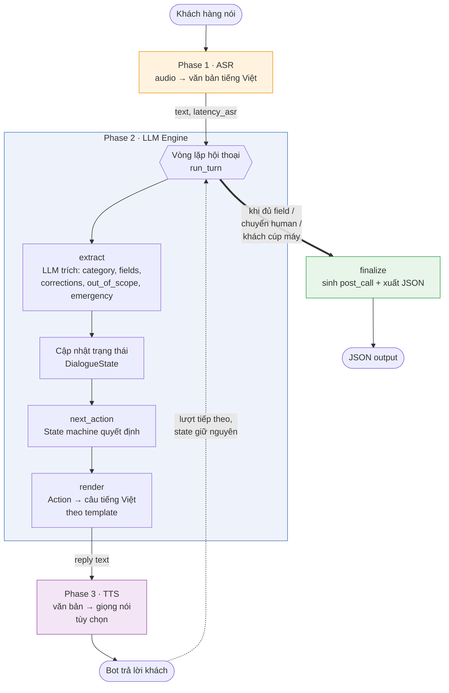
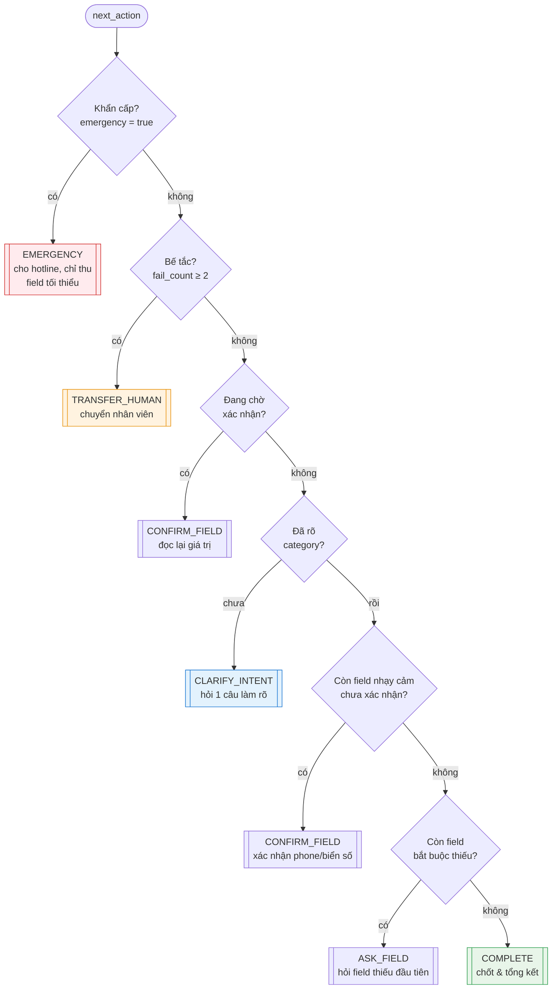

# Tài liệu Kiến trúc — Callbot Chăm sóc Khách hàng Tiếng Việt (VinFast)

**Phạm vi:** Hệ thống tổng đài AI tiếng Việt xử lý 5 nhóm cuộc gọi của khách hàng VinFast — nhận giọng nói, hiểu và quản lý hội thoại, thu thập thông tin, và xuất bản ghi cấu trúc cuối mỗi cuộc gọi.

---

## 1. Tổng quan

Hệ thống nhận cuộc gọi bằng tiếng Việt, chuyển giọng nói thành văn bản (ASR), dùng một mô hình ngôn ngữ lớn (LLM) để hiểu ý định và quản lý hội thoại, trả lời khách, và cuối cuộc gọi sinh ra một JSON tổng kết gồm loại cuộc gọi, các trường thông tin đã thu, và phần phân tích sau cuộc gọi (tóm tắt, cảm xúc, cờ khẩn cấp).

Mục tiêu thiết kế không phải một hệ thống production hoàn chỉnh, mà là một kiến trúc thể hiện rõ tư duy thiết kế, hội thoại mượt trên cả 5 nhóm, và đặc biệt là **xử lý lỗi và bàn giao cho người thật một cách trung thực**. Một bot biết phục hồi khi gặp lỗi và chuyển tiếp đúng lúc được ưu tiên hơn một bot chỉ chạy được trong kịch bản lý tưởng.

**Nguyên tắc kiến trúc xuyên suốt:** một máy trạng thái (state machine) xác định cầm lái toàn bộ luồng hội thoại; LLM chỉ đảm nhận hai việc hẹp là *trích xuất thông tin* và *diễn đạt câu trả lời*. Đây là quyết định trung tâm của toàn bộ thiết kế và sẽ được giải thích ở Mục 4.

---

## 2. Kiến trúc Pipeline

Pipeline gồm ba phase: ASR (bắt buộc), LLM (bắt buộc), và TTS (tùy chọn). Một đối tượng trạng thái duy nhất được giữ xuyên suốt cuộc gọi, đóng vai trò "trí nhớ" để hệ thống không hỏi lại thông tin đã thu.



Mỗi lượt hội thoại chỉ thực hiện **một** lần gọi LLM (cho bước `extract`). Bước `render` dùng template xác định, không gọi LLM — quyết định này được giải thích ở Mục 7.

---

## 3. Lựa chọn mô hình

| Thành phần | Lựa chọn | Lý do |
|------------|----------|-------|
| ASR | PhoWhisper-medium *hoặc* mô hình LoRA fine-tune nội bộ (whisper-small) | Thiết kế cho phép hoán đổi (swappable) qua một interface chung, biến việc chọn ASR thành một phần của quy trình đánh giá: benchmark cả hai trên cùng bộ audio rồi chọn. |
| LLM | Qwen2.5-7B-Instruct, lượng tử hóa 4-bit (NF4) | Hệ thống sống bằng việc trích xuất JSON có cấu trúc và tuân thủ chỉ dẫn; Qwen2.5 mạnh ở khoản này và xử lý tiếng Việt tốt. Bản 4-bit vừa khít GPU T4 16GB. |
| TTS (tùy chọn) | viXTTS / F5-TTS-Vietnamese | Tổng hợp giọng tiếng Việt chất lượng, mã nguồn mở. |

Môi trường chạy là GPU T4 (Colab/Kaggle). Độ trễ trên T4 cao hơn hạ tầng production là điều dự kiến; hệ thống đo và báo cáo độ trễ trung thực thay vì nhắm tới một ngưỡng cố định.

Lưu ý quan trọng: cả hai mô hình ASR đều không được huấn luyện trên từ vựng riêng của VinFast (tên dòng xe như "VF8", biển số, số VIN), nên dễ nhận dạng sai các giá trị này. Đây chính là lý do tồn tại của cơ chế xác nhận lại giá trị nhạy cảm (Mục 6).

---

## 4. Nguyên tắc thiết kế hội thoại: State machine cầm lái, LLM phục vụ

Đây là quyết định kiến trúc trung tâm. Thay vì giao toàn bộ việc quản lý hội thoại cho LLM qua một prompt lớn, hệ thống tách bạch hai vai trò:

- **State machine (xác định)** quyết định *làm gì tiếp theo*: đã đủ thông tin chưa, còn thiếu trường nào, có cần xác nhận lại không, đã bế tắc chưa, có khẩn cấp không.
- **LLM (phi xác định)** chỉ làm hai việc hẹp: *trích xuất* thông tin từ câu khách nói, và (ở phiên bản này, được thay bằng template) *diễn đạt* câu trả lời.

Lợi ích trực tiếp: phần lớn logic xử lý ngoại lệ nằm trong mã xác định, có thể kiểm chứng bằng unit test, thay vì phụ thuộc vào việc LLM "nhớ" tuân thủ chỉ dẫn. Sáu trong tám tình huống ngoại lệ được giải quyết hoàn toàn trong state machine; chỉ hai tình huống (ngoài phạm vi, khẩn cấp) cần LLM nhận diện ngữ nghĩa.

Hàm quyết định `next_action` chạy theo thứ tự ưu tiên cố định:



Thứ tự ưu tiên này phản ánh logic nghiệp vụ: an toàn tính mạng trước hết, kế đến là không để khách mắc kẹt, rồi mới tới việc thu thập thông tin theo trình tự hợp lý.

---

## 5. Domain: 5 nhóm cuộc gọi và bản ghi đầu ra

| Mã | Nhóm | Mục tiêu |
|----|------|----------|
| G_1 | Cứu hộ | Nhận báo hỏng xe, điều phối cứu hộ / dịch vụ |
| G_2 | Bảo hành & Sửa chữa | Tư vấn chính sách bảo hành, cung cấp thông tin trung tâm dịch vụ |
| G_3 | Đơn hàng | Tình trạng đơn, chuyển cọc, cập nhật thông tin đơn |
| G_4 | Xe máy – Bảo hành | Bảo hành xe máy điện, chỉ trung tâm gần nhất |
| G_5 | Hỗ trợ kỹ thuật từ xa | Hướng dẫn khắc phục từ xa, đặt lịch nếu không xử lý được |

Định nghĩa trường thông tin của từng nhóm được tập trung tại một nơi duy nhất (module schema), đóng vai trò nguồn chân lý chung cho cả state machine, prompt của LLM, và bộ đánh giá. Sửa định nghĩa ở một chỗ là toàn hệ thống đồng bộ.

Cuối mỗi cuộc gọi, hệ thống sinh bản ghi:

```json
{
  "category": "G_1",
  "fields": { "full_name": "...", "phone": "...", "...": "..." },
  "post_call": {
    "short_summary": "Tóm tắt 1–2 câu về cuộc gọi và hành động đã thực hiện",
    "sentimental_analysis": "calm | frustrated | urgent",
    "emergency": "yes | no"
  }
}
```

Phần `post_call` được sinh từ toàn bộ bản ghi hội thoại ở cuối cuộc gọi, không thu thập trong lúc đối thoại. Nếu khách cúp máy giữa chừng, bản ghi vẫn được xuất với các trường chưa thu được đánh dấu `null`.

---

## 6. Xử lý ngoại lệ

Tám tình huống ngoại lệ bắt buộc và cơ chế xử lý tương ứng:

| Tình huống | Hành vi | Cơ chế |
|------------|---------|--------|
| Thiếu trường | Chỉ hỏi trường còn thiếu, không hỏi lại trường đã có | State machine: `missing_required` → `ASK_FIELD` |
| Khách sửa thông tin | Cập nhật giá trị, không lặp lại trường đã xác nhận | State machine: `correct` |
| Ý định mơ hồ | Hỏi một câu làm rõ trước khi định tuyến, không suy đoán | State machine: `CLARIFY_INTENT` |
| Ngoài phạm vi | Lịch sự chuyển hướng hoặc đề nghị nối máy nhân viên | LLM nhận diện `out_of_scope` → render |
| Đầu vào không rõ | Đọc lại giá trị (số điện thoại, biển số) để xác nhận trước khi ghi | Trường gắn cờ `verify` → `CONFIRM_FIELD` |
| Khẩn cấp | Ưu tiên tuyệt đối, cung cấp hotline, bỏ qua trường phụ | LLM nhận diện `emergency` → ưu tiên cao nhất trong state machine |
| Bế tắc sau 2+ lượt | Đề nghị nối máy nhân viên | State machine: `fail_count ≥ 2` → `TRANSFER_HUMAN` |
| Khách cúp máy giữa chừng | Xuất JSON một phần, trường thiếu = `null` | `mark_hung_up` + `to_output` |

Cơ chế xác nhận giá trị nhạy cảm đáng được nhấn mạnh: vì ASR dễ nghe sai số và biển số (do thiếu từ vựng domain), các trường này được gắn cờ `verify`. Hệ thống chỉ coi chúng là "đã có" sau khi khách xác nhận lại — biến một điểm yếu kỹ thuật của ASR thành một bước hội thoại có chủ đích.

---

## 7. Các quyết định thiết kế và đánh đổi

**Chỉ dùng LLM để trích xuất; diễn đạt bằng template.** Trên GPU T4, mỗi lần gọi LLM 7B mất khoảng 1–3 giây. Nếu cả bước diễn đạt cũng gọi LLM thì độ trễ mỗi lượt tăng gấp đôi và xuất hiện thêm một điểm có thể lỗi (LLM sinh câu lạc đề hoặc sai định dạng). Các câu trả lời trong hệ thống có cấu trúc rõ (hỏi một trường, xác nhận một giá trị, thông báo chuyển máy), nên template tiếng Việt vừa đủ tự nhiên, vừa nhanh, vừa kiểm soát hoàn toàn. Đánh đổi: câu trả lời ít biến hóa hơn so với để LLM tự sinh. Trong bối cảnh tổng đài, tính nhất quán và độ trễ thấp được ưu tiên hơn sự đa dạng câu chữ.

**Một đối tượng trạng thái giữ xuyên suốt cuộc gọi.** Đây là điều cho phép bot không hỏi lại thông tin đã thu và xử lý mạch lạc việc sửa thông tin giữa chừng.

**ASR hoán đổi được.** Interface chung cho phép thử nhiều mô hình mà không đụng tới phần còn lại của pipeline, đồng thời biến việc so sánh mô hình thành một thí nghiệm đo lường được trong báo cáo đánh giá.

**Lượng tử hóa 4-bit thay vì bản đầy đủ.** Đổi một phần nhỏ độ chính xác lấy khả năng chạy trọn vẹn trên một GPU T4 phổ thông — phù hợp với mục tiêu tái lập được trên hạ tầng miễn phí.

---

## 8. Đối chiếu với hệ thống production

Phiên bản này có chủ đích đơn giản hóa so với một callbot giọng nói production thực thụ. Việc nêu rõ khác biệt giúp định vị các lựa chọn thiết kế:

| Khía cạnh | Phiên bản này | Hệ thống production |
|-----------|---------------|---------------------|
| Luồng âm thanh | Theo lượt (turn-based) | Streaming realtime, phát hiện lượt nói (turn detection), ngắt lời (barge-in) |
| Kết nối | Micro / file audio | Telephony qua SIP trunking, WebRTC |
| Quản lý hội thoại | State machine + LLM trích xuất | Tương tự, bổ sung gọi hàm (function calling) tới hệ thống thật |
| Hành động | Xuất JSON | Gọi API thật: điều xe cứu hộ, tra cứu CRM, đặt lịch |
| Tư vấn chính sách | (ngoài phạm vi) | Truy xuất tri thức (RAG) từ cơ sở dữ liệu chính sách |
| Giám sát | Log + đo độ trễ | Observability/tracing đầy đủ, đánh giá liên tục |

Nguyên tắc tách state machine khỏi LLM trong phiên bản này chính là nền tảng mà một hệ thống production mở rộng lên — bằng cách thay bước "xuất JSON" bằng các lời gọi hàm tới hệ thống nghiệp vụ, và thay ASR/TTS theo lượt bằng phiên bản streaming.

---

## 9. Giới hạn đã biết

- **Từ vựng domain:** ASR chưa được tinh chỉnh cho thuật ngữ VinFast, dễ sai tên dòng xe và mã định danh. Cơ chế xác nhận giảm thiểu rủi ro này nhưng không loại bỏ hoàn toàn.
- **Độ trễ:** Trên GPU T4, độ trễ mỗi lượt cao hơn hạ tầng production; hệ thống đo và báo cáo trung thực thay vì tối ưu cho một ngưỡng cụ thể.
- **Phụ thuộc chất lượng trích xuất của LLM:** Việc định tuyến nhóm và thu trường phụ thuộc vào độ chính xác của bước `extract`; các trường hợp lỗi được phân tích trong báo cáo đánh giá.
- **Tư vấn chính sách:** Phiên bản này tập trung vào thu thập thông tin và định tuyến; phần tư vấn nội dung chính sách (bảo hành, đơn hàng) là hướng mở rộng qua RAG.

---

## 10. Hướng phát triển

Theo thứ tự ưu tiên nếu mở rộng: tích hợp gọi hàm tới hệ thống nghiệp vụ thật (thay bước xuất JSON); bổ sung truy xuất tri thức cho phần tư vấn chính sách; tinh chỉnh ASR trên từ vựng VinFast; và chuyển sang luồng âm thanh streaming với phát hiện lượt nói cho trải nghiệm tự nhiên hơn.
```