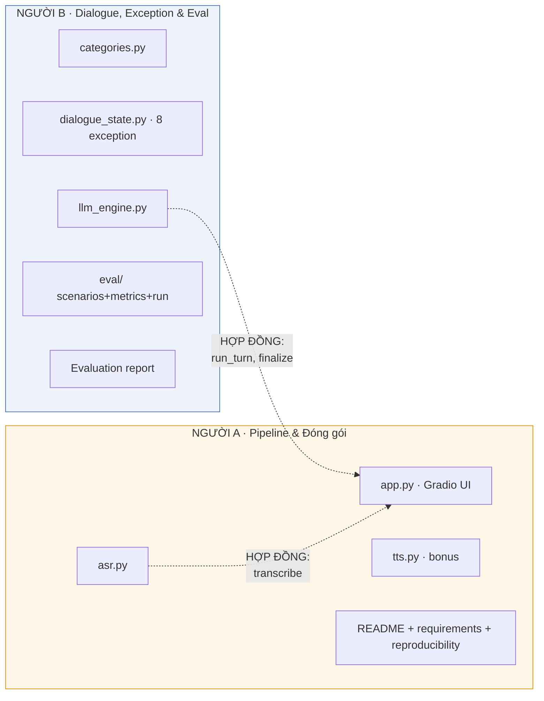

# Kế hoạch chia việc — Callbot Tiếng Việt VinFast (2 người)

> Deadline: thứ Năm tuần sau.
> Hai nhánh gặp nhau ở hợp đồng interface (Mục 4) và bước tích hợp (Mục 5).

---

## 1. Phân công

| | **Người A — Pipeline kỹ thuật & Đóng gói** | **Người B — Dialogue, Exception & Evaluation** |
|---|---|---|
| Sở hữu file | `asr.py`, `app.py`, `tts.py`, `requirements.txt`, `README.md` | `categories.py`, `dialogue_state.py`, `llm_engine.py`, `eval/` |
| Deliverable | Working bot chạy end-to-end + đóng gói + reproducibility | Dialogue engine + xử lý exception + Evaluation framework + report |
| Điểm phụ trách | 30đ Pipeline + 20đ Code quality + 5đ TTS | 25đ Dialogue & Exception + 25đ Evaluation |



---

## 2. NGƯỜI A — Pipeline kỹ thuật & Đóng gói

### Đã có
- [x] `asr.py` — wrapper swappable (PhoWhisper / model LoRA), phần xử lý audio đã test ok

### Việc còn lại
- [ ] Test `asr.py` trên Colab GPU — chạy thật cả 2 backend (`phowhisper`, `lora`).
- [ ] Benchmark 2 ASR: chạy cùng bộ clip, đo WER + latency, chọn cái dùng chính. Đưa số cho B.
- [ ] `app.py` — Gradio UI:
  - Chat nhiều lượt: `gr.Audio(sources=["microphone"])`, bot nhớ cả cuộc gọi.
  - Giữ 1 `DialogueState` qua các lượt bằng `gr.State`.
  - Mỗi lượt: audio → `asr.transcribe` → `llm_engine.run_turn` → hiện transcript + reply.
  - Nút "Kết thúc cuộc gọi" → `state.mark_hung_up()` (nếu chưa complete) → `finalize()` → hiện JSON.
  - Load LLM + ASR một lần (global), không load lại mỗi lượt.
  - Hiển thị latency mỗi lượt (asr + llm).
- [ ] `tts.py` (bonus +5, làm cuối): `speak(text) → audio` bằng viXTTS / F5-TTS, cắm vào app.
- [ ] Đóng gói: `requirements.txt` (pin version), `.env.example`, `.gitignore` (chặn `.env`), `README.md`.
- [ ] Reproducibility check: clone sạch → cài → chạy lại được.
- [ ] Architecture doc (`architecture_document.md`, đã có nháp): hoàn thiện mục pipeline/model/product.

### Không đụng vào
`dialogue_state.py`, `llm_engine.py`, `categories.py` — chỉ gọi `run_turn`/`finalize`/`transcribe`.

---

## 3. NGƯỜI B — Dialogue, Exception & Evaluation

### Đã xong (duy trì & tinh chỉnh)
- [x] `categories.py` — schema 5 category
- [x] `dialogue_state.py` — state machine, 6/8 exception trong code xác định
- [x] `llm_engine.py` — load Qwen2.5-7B-4bit, `extract`, `render`, `run_turn`, `finalize`
- [x] Đã chạy thật trên Colab, test text-mode 8 exception đều đúng

### Việc còn lại
- [ ] Tinh chỉnh prompt `extract` nếu LLM trả JSON lỗi: thêm few-shot tiếng Việt vào `EXTRACT_SYSTEM`.
- [ ] Rà soát & hoàn thiện đủ 8 exception (đặc biệt out_of_scope & emergency do LLM nhận diện).
- [ ] `eval/scenarios.py` — ≥10 kịch bản (≥2/category) + ≥3 exception scenario. Mỗi scenario = lượt thoại (text) + kết quả mong đợi (category, field, action).
- [ ] `eval/metrics.py`: slot-filling accuracy, routing accuracy, LLM-as-judge (automated metric bắt buộc).
- [ ] `eval/run_eval.py` — chạy tất cả scenario ở text-mode, tổng hợp kết quả + failure analysis trung thực.
- [ ] Evaluation report (tài liệu nộp): kết quả mọi metric + failure analysis + giới hạn. Latency lấy số từ A.
- [ ] Architecture doc: hoàn thiện mục dialogue/exception/trade-off/giới hạn.

### Không đụng vào
`asr.py`, `app.py`, `tts.py` — test bộ não hoàn toàn bằng text input.

---

## 4. Hợp đồng interface (cả 2 tôn trọng, không đổi nếu chưa bàn)

```python
# Người B cung cấp (llm_engine.py):
llm = LLM()
reply, action = run_turn(state, user_text, llm)
result_json = finalize(state, llm)

# Người B cung cấp (dialogue_state.py):
state = DialogueState()
state.mark_hung_up()
state.status.value          # "active" | "completed" | "transferred" | "hung_up"

# Người A cung cấp (asr.py):
asr = ASR(backend="phowhisper")     # hoặc "lora"
text, latency = asr.transcribe(audio)
```

---

## 5. Điểm đồng bộ

1. Bộ não đã ổn định → A viết app gọi `run_turn` được ngay.
2. Latency: A đo trong app/benchmark → đưa số cho B ghi vào eval report.
3. Tích hợp app: `app.py` là chỗ 2 nhánh gặp nhau. Ráp + test chung 1 buổi, đừng để sát deadline.
4. Architecture doc: A mục pipeline/model, B mục dialogue/exception/giới hạn.
5. Git: mỗi người một branch (`feat/app`, `feat/dialogue-eval`), merge qua PR.

---

## 6. Timeline (đến thứ Năm tuần sau)

| Ngày | Người A (Pipeline & Đóng gói) | Người B (Dialogue, Exception & Eval) |
|------|-------------------------------|--------------------------------------|
| 1–2 | Test `asr.py` GPU + benchmark 2 model | Rà 8 exception + tinh chỉnh prompt + `eval/scenarios.py` |
| 3–4 | `app.py` (text trước rồi gắn mic) | `metrics.py` + `run_eval.py` + chạy thử |
| 5 | TTS (nếu kịp) + đóng gói (README, requirements) | Chạy full eval + bắt đầu eval report |
| 6 | Reproducibility check + polish UI | Hoàn thiện eval report |
| 7 | Cùng ráp app + test end-to-end + rà tài liệu + nộp | (chung) |

Ưu tiên nếu thiếu thời gian: bỏ TTS trước (A), giữ tối thiểu 10 scenario (B). Không bỏ: app chạy được, eval cơ bản, 2 tài liệu.

---

## 7. Trạng thái tổng

- [x] Bộ não hội thoại (3 file) — xong, chạy thật — B
- [x] `asr.py` — viết xong, chờ test GPU — A
- [x] Architecture document — bản nháp xong (cả 2 hoàn thiện theo mục)
- [ ] `app.py` — A
- [ ] `tts.py` — tùy chọn — A
- [ ] Đóng gói (README, requirements, .env, .gitignore) — A
- [ ] Reproducibility check — A
- [ ] `eval/` — B
- [ ] Evaluation report — B